

  <picture>
    <source media="(prefers-color-scheme: dark)" srcset="images/titre-principal-sombre.png">
    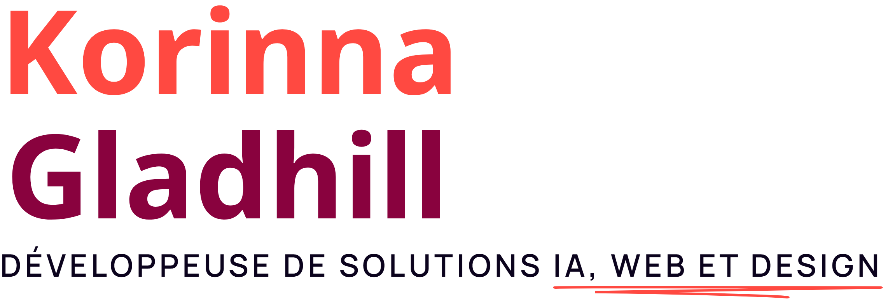
  </picture>

  
  <a href="https://korinnagladhill.com">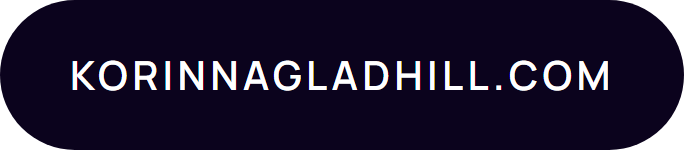</a>

<h3>
  <picture>
    <source media="(prefers-color-scheme: dark)" srcset="images/titre-a-propos-sombre.png">
    
  </picture>
</h3>

Je conçois des **outils** sur mesure et des **visuels** soignés qui simplifient le travail, **automatisent** ce qui peut l’être et transforment les idées en solutions concrètes, fiables, esthétiques et faciles à utiliser.

- **Développement web & design graphique** · HTML/CSS, JS, WordPress, Figma, GitHub
- **Médias sociaux & marketing** · Instagram, Meta Ads, Facebook, YouTube, Google
- **Solutions IA & création d’apps** · Codex, Superscale, Claude, Gemini, MCPs

<h3>
  <picture>
    <source media="(prefers-color-scheme: dark)" srcset="images/titre-projets-sombre.png">
    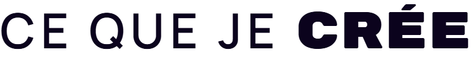
  </picture>
</h3>

<a href="https://korinnagladhill.com/projets/hibakes/">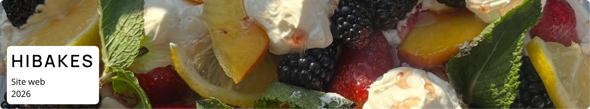</a>

<a href="https://korinnagladhill.com/projets/satellite/">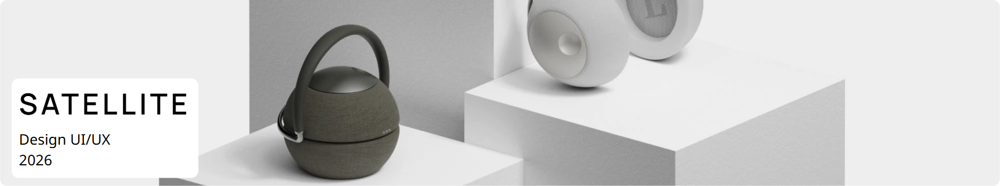</a>

<a href="https://korinnagladhill.com/projets/cafe-lux/">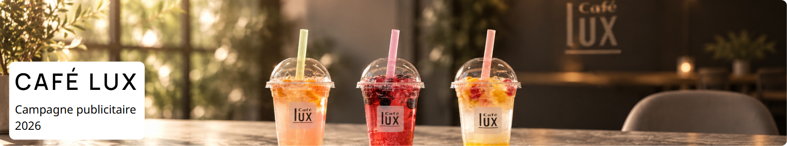</a>

<a href="https://korinnagladhill.com/projets/sat/">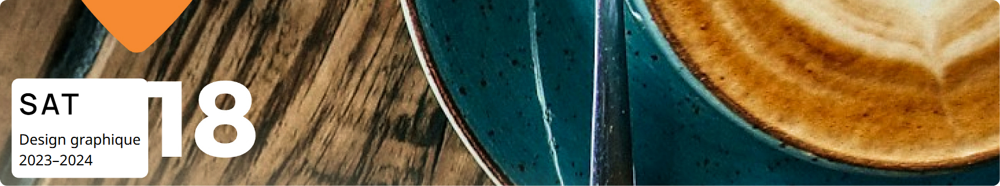</a>

<a href="https://korinnagladhill.com/projets/goals/">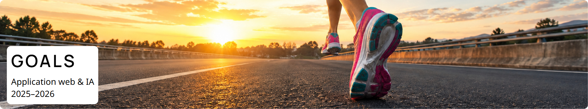</a>

<a href="https://korinnagladhill.com/projets/">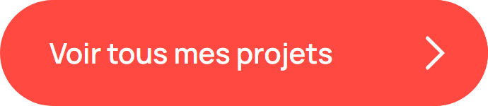</a>

<h3>
  <picture>
    <source media="(prefers-color-scheme: dark)" srcset="images/titre-template-sombre.png">
    
  </picture>
</h3>

[**web-ai-template**](https://github.com/KorinnaG/web-ai-template) est le template de projet web IA que j’ai créé : le point de départ de mes projets web développés avec des agents IA. Il réunit :

- un `AGENTS.md` à remplir, le point d’entrée que chaque agent lit avant de commencer ;
- un plan commun en sous-module : normes (architecture, sécurité, accessibilité, tests, qualité), workflows (nouvelle fonctionnalité, correction de bogue, mise en ligne…) et une vingtaine de compétences (planification, revue de code, audit d’accessibilité, QA visuelle, SEO…) ;
- un dossier `decisions/` pour les décisions d’architecture (ADR) et un `.env.example` sans aucun secret.

C’est ce template qui encadre le développement de mon portfolio.

<a href="https://github.com/KorinnaG/web-ai-template">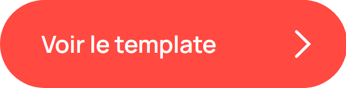</a>

<h3>
  <picture>
    <source media="(prefers-color-scheme: dark)" srcset="images/titre-discute-sombre.png">
    
  </picture>
</h3>

Je suis à la recherche d’une équipe innovatrice qui veut accueillir une **stagiaire** motivée en **développement web** ou bien en développement de **solutions IA**, du 29 mars au 27 mai 2027.

Si c’est toi, je serai **ravie** de faire ta connaissance !

<a href="https://korinnagladhill.com/contact/">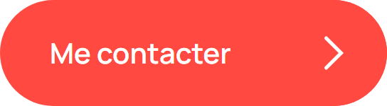</a>

[Courriel](mailto:korinna.gladhill@gmail.com) · [LinkedIn](https://www.linkedin.com/in/korinna-gladhill-36a22a247/) · [GitHub](https://github.com/KorinnaG) · [Instagram](https://www.instagram.com/annirok8/) · [YouTube](https://www.youtube.com/@Korinna-g3t) · [Mon CV](https://korinnagladhill.com/documents/cv-korinna-gladhill.pdf)

<!-- Images générées à partir du portfolio (contenus, polices, couleurs) : node source/generer.mjs -->
